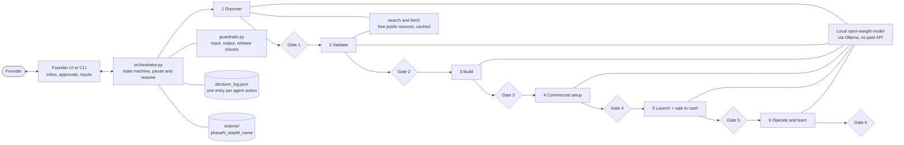
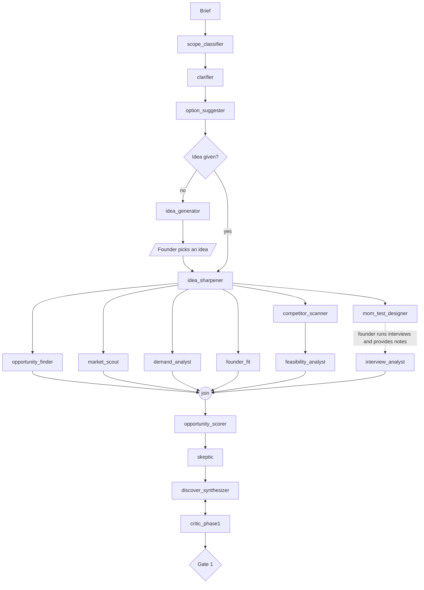
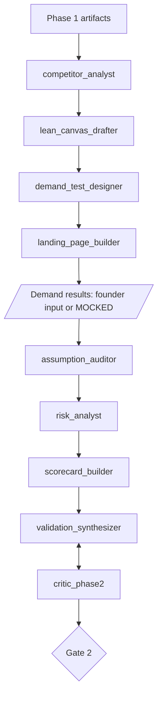
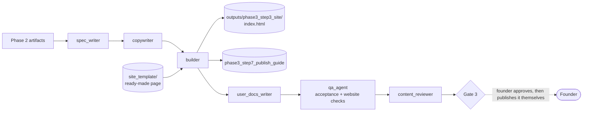
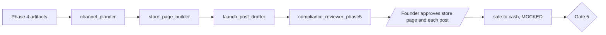
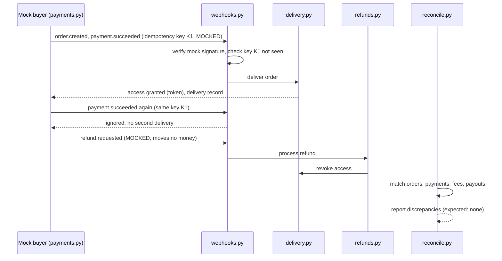
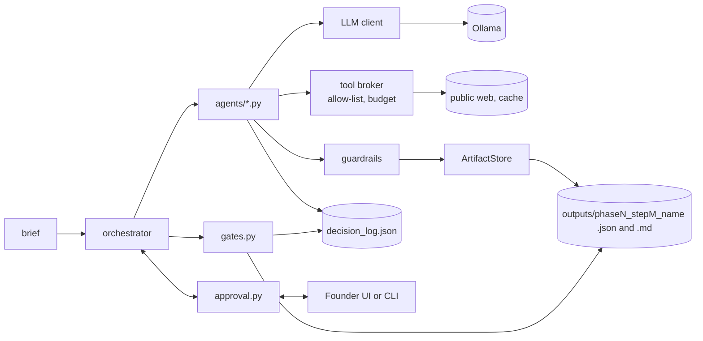

# Architecture

## Overview

This system is an open-source team of AI agents that takes a founder's brief toward a validated, sellable **digital** product through six phases: Discover, Validate, Build, Commercial setup, Launch (including mocked sale-to-cash), and Operate and learn. Every phase ends with a gate whose pass criteria are written **before** the phase collects evidence. A gate returns `go`, `repeat`, `pivot` or `stop`, and the founder approves or overrides every verdict. Control is plain code (orchestrator, gates, guardrails, approval); AI agents only produce content inside that frame. Nothing is published, sent, spent or signed without a founder approval enforced in code, and no payment of any kind is made: payments are mocked and labeled.

**Principles.** (1) Control is code, not prompt. (2) Agents never talk to each other: they read and write typed artifacts in `outputs/`, routed by the orchestrator. (3) Every market claim carries a source URL and an exact quote that code re-checks, or is labeled `ASSUMPTION`. (4) The system can say stop: gate criteria are fixed in advance and code applies them. (5) Everything that is mocked is labeled `MOCKED` or `STUBBED`.

**Models.** One open-weight model served by Ollama (default `qwen3:8b`, configurable, for example `gpt-oss:20b`). No paid API is required. Cost per run is measured from token counts.

## Phases

All agents are files in `agents/<role>.py` with a matching prompt in `prompts/<role>.md`. Each writes one artifact named `outputs/phase<N>_step<M>_<name>` (`.json` for code, `.md` for people). Agents inside one **parallel stage** run together; stages run in order. `kind` is `llm` (model call), `code` (no model) or `founder` (waits for the founder).

### Phase 1: Discover (Core step: Find opportunities)

Goal: sharpen the founder's starting idea, score it against alternatives, define the market, interview customers (Mom Test).

| Agent | Kind | Tools | Method | Output artifact |
|---|---|---|---|---|
| scope_classifier | llm | none | Classify digital, not digital or undetermined; refuse physical goods, financial or crypto, health and legal advice products | `phase1_step1_scope` |
| clarifier | founder | none | Rank missing brief fields by decision impact; ask 3 to 4 questions per round, 2 rounds; re-ask unanswered ones; first question is what is sold and whether it is digital | `phase1_step2_clarification` |
| option_suggester | llm | none | When the founder says "I don't know" (a field is asked once, never repeated), propose 2 to 3 options; the founder approves one, writes their own, asks for different options (never repeating a shown one) or leaves it open; nothing is silently assumed | `phase1_step2_options` |
| idea_generator | llm | search | Only if there is no idea: candidate ideas from the founder's skills, time, budget and values, with sources | `phase1_step3_idea_candidates` |
| (founder pick) | founder | none | The founder chooses or supplies an idea; logged | `phase1_step3_idea_choice` |
| idea_sharpener | llm | none | Restate the idea as an Idea Card (customer, problem, solution, value proposition) and testable hypotheses; reads `pivot_notes` after a pivot | `phase1_step4_idea_card` |
| opportunity_finder | llm | search, fetch | Find alternative ideas in the same space, with sources | `phase1_step5_opportunities` |
| market_scout | llm | search, fetch | Define the market and check whether people want it; claims with exact quotes | `phase1_step5_market` |
| demand_analyst | llm | search, fetch | Do people already pay for substitutes? Price signals, repeated requests | `phase1_step5_demand_signals` |
| competitor_scanner | llm | search, fetch | Brief scan of top rivals and what they charge, as stated | `phase1_step5_competitors` |
| founder_fit | llm | none | Compare the idea with the founder's skills, time and values; one rating | `phase1_step5_founder_fit` |
| mom_test_designer | llm | none | Write the interview script (questions about the customer's past behavior, not the idea) | `phase1_step5_interview_script` |
| feasibility_analyst | llm | none | Effort for the minimum viable scope (from rival features) vs the founder's hours and budget; one rating | `phase1_step6_feasibility` |
| interview_analyst | founder + llm | none | Waits for the founder's interview notes; extracts pain points, current solutions, commitment signals; never invents interviews | `phase1_step6_interview_findings` |
| opportunity_scorer | llm | none | Rank the idea against the alternatives using all evidence; keep the ranking as pivot targets | `phase1_step7_opportunity_scores` |
| skeptic | llm | none | Challenge the ranking and the leading option: risks, kill criteria, what would change the verdict | `phase1_step8_skeptic` |
| discover_synthesizer | llm | none | Hedged report; every finding cites a claim or is an assumption | `phase1_step9_discover_report` |
| critic_phase1 | llm | none | Flag unsupported claims, flattery, missing risks; up to 2 revision rounds | `phase1_step9_critique` |

Gate 1 output: `outputs/phase1_gate_decision.md`.

### Phase 2: Validate (Core step: Design the business)

Goal: Lean Canvas, then test demand with a landing page against a target set in advance.

| Agent | Kind | Tools | Method | Output artifact |
|---|---|---|---|---|
| competitor_analyst | llm | none | Deep analysis of the scanner's evidence: positioning, pricing gaps, five forces | `phase2_step1_competitor_analysis` |
| lean_canvas_drafter | llm | none | Fill the nine Lean Canvas boxes; every statement sourced or `ASSUMPTION`; no payments | `phase2_step2_lean_canvas` |
| demand_test_designer | llm | none | Hypothesis, sign-up target set in advance (for example 100 in 14 days), how to read it, traffic sources | `phase2_step3_demand_test_plan` |
| landing_page_builder | llm | none | Build the test page from the plan: no fake counters, timers or reviews; a draft for founder approval | `phase2_step4_landing_page` (`.html`) |
| (demand results) | founder | none | Real sign-up count from the founder, or a labeled `MOCKED` input in the demo; the run pauses until it arrives | `phase2_step5_demand_results` |
| assumption_auditor | llm | none | List every assumption, tested or not, cheapest test for each | `phase2_step6_assumptions` |
| risk_analyst | llm | none | Top risks, kill criteria, what would change the verdict. A kill criterion counts as triggered only when it names its evidence (checked in code); "no evidence of X" is unknown, never a kill; the demand rule (ratio below 0.2) is decided in code | `phase2_step7_risks` |
| scorecard_builder | llm | none | Rate six dimensions (problem severity, demand evidence, competition, founder fit, feasibility, monetization); no evidence means `unknown`; a `MOCKED` demand result is capped at `adequate` in code | `phase2_step8_scorecard` |
| validation_synthesizer | llm | none | Final report including the risk analyst's findings; does not choose the verdict | `phase2_step9_validation_report` |
| critic_phase2 | llm | none | Review the report; up to 2 revision rounds. A `MOCKED` or `SAMPLE` input is acceptable when the report states its provenance. Code downgrades a must-fix that only disputes a rule code has already applied (`downgraded_by_code`, reason recorded); real problems stay must-fix | `phase2_step9_critique` |

Gate 2 output: `outputs/phase2_gate_decision.md`.

### Phase 3: Build (Core step: Build the product)

Goal: ship a tested MVP: **one website for the founder's product**, plus user docs. The system builds and tests the site; it never publishes it.

| Agent | Kind | Method | Output artifact |
|---|---|---|---|
| spec_writer | llm | MVP scope and user stories. The acceptance tests are structural and set in code (the page exists, every required section exists, the demo sign-up label is shown); the model's own tests are recorded in `dropped_tests` and never run | `phase3_step1_spec` |
| copywriter | llm | Reuse the tested landing copy; add features and FAQ; no fake reviews or counts | `phase3_step2_page_copy` |
| builder | llm + code | The model writes structured content only (headline, value proposition, features, FAQ, claims). Code fills the ready-made template `site_template/index.html` with HTML escaping and writes the website to `outputs/phase3_step3_site/`; also writes the publish guide. No deploy, no network code, no payment form | `phase3_step3_build`, `phase3_step3_site/`, `phase3_step7_publish_guide` |
| user_docs_writer | llm | User guide from the built product | `phase3_step4_user_docs` |
| qa_agent | code | Run the structural acceptance checks and the website checks (below) against the files; no model is used; report pass or fail honestly | `phase3_step5_qa_report` |
| content_reviewer | llm | Honesty review: fake proof, promises, invented numbers, unlabeled samples. Code downgrades a must-fix that disputes a rule the website checks already apply (source link or `ASSUMPTION` label present, demo label present, no urgency wording, price slot filled by code) or that only asks for a source on the product's own description (the founder's design); fake proof and market claims stay must-fix | `phase3_step6_content_review` |

**The founder's website** (`outputs/phase3_step3_site/index.html`):
- One folder, no build step: CSS inline, opens by double-click. Sections: value proposition, features, evidence, price, FAQ, policy links, sign-up box.
- Filled from a ready-made template with the approved Idea Card and the verified claims from Phases 1 and 2. Every market claim on the page links its source or is labeled `ASSUMPTION`. In Phase 3 the price slot reads "Price: set in Phase 4"; Phase 5 re-fills the same template with the price and policy pages.
- The sign-up box is a demo: a form with no action and no script, labeled "Demo only: nothing is sent or stored". No sign-up, waitlist or user number is ever shown, even labeled; "SIMULATED, not real users" only labels other simulated example numbers. No payment code, testimonials, counters, timers or income claims.
- **Website checks** (code, in `qa_agent`): the HTML parses; the required sections exist; every local link and anchor resolves; external links are well-formed; a banned-content scan (guardrails: income promises, fake reviews or counts, urgency, impersonation) finds nothing; every claim on the page is sourced or labeled `ASSUMPTION` (a claim is shown as a fact only if its quote also supports it); the sign-up box is inert and labeled. The result is the gate metric `site_checks_passed`.
- **Never published by the system.** The founder approves it at Gate 3, previews it in the founder UI (**Preview website**, served locally with a policy that blocks scripts, network calls and form submission), downloads it (**Download site folder**), and publishes it themselves following `phase3_step7_publish_guide.md` (for example GitHub Pages or Netlify).

Gate 3 output: `outputs/phase3_gate_decision.md`.

### Phase 4: Commercial setup (Core step: Set the price and policies)

Goal: set the price and draft the policies. No payments of any kind.

| Agent | Kind | Method | Output artifact |
|---|---|---|---|
| pricing_analyst | llm | Price and range from sourced comparables (reuses Phase 1 and 2 claims) or labeled assumption | `phase4_step1_pricing` |
| offer_packager | llm | Tiers, positioning, value statements; no income claims | `phase4_step2_offer` |
| policy_drafter | llm | Draft terms, privacy and refund policy, each marked "needs legal review"; no compliance claims | `phase4_step3_policies` |
| compliance_reviewer_phase4 | llm | Banned claims and missing legal-review labels | `phase4_step4_compliance_review` |

Gate 4 output: `outputs/phase4_gate_decision.md`.

### Phase 5: Launch (Core step: Open the store; deliver automatically, MOCKED)

Goal: open the store and deliver the product to buyers automatically (mocked).

| Agent or module | Kind | Method | Output artifact |
|---|---|---|---|
| channel_planner | llm | 2 to 3 channels, each tied to evidence of where the audience is | `phase5_step1_channel_plan` |
| store_page_builder | llm + code | Re-fill the Phase 3 website template with the Phase 4 price, offer and policy pages (each marked "needs legal review"); same checks as Phase 3; no fake counters or timers | `phase5_step2_store_page`, `phase5_step2_store_site/` |
| launch_post_drafter | llm | Launch posts as drafts; the founder approves each; nothing is posted | `phase5_step3_launch_posts` |
| compliance_reviewer_phase5 | llm | No fake proof, urgency or promises | `phase5_step4_launch_review` |
| `payments.py`, `webhooks.py`, `delivery.py`, `refunds.py`, `reconcile.py` | code | Mocked sale to cash; see below | `payment_test_log` |

Gate 5 output: `outputs/phase5_gate_decision.md`.

### Phase 6: Operate and learn (no Core step: support, metrics, persevere-or-pivot memo)

Goal: support, metrics, persevere-or-pivot memo. Inputs are labeled `SAMPLE` or `MOCKED` because no real customers exist during the hackathon.

| Agent | Kind | Method | Output artifact |
|---|---|---|---|
| support_drafter | llm | Draft replies to questions the founder provides; money, account and legal topics escalate to the founder; never promises refunds | `phase6_step1_support_replies` |
| metrics_analyst | llm | Compare results with the Phase 2 targets; label input provenance | `phase6_step2_metrics` |
| persevere_pivot_memo | llm | Memo recommending persevere, pivot or stop with reasons and 1 to 3 experiments | `phase6_step3_persevere_pivot_memo` |

Gate 6 output: `outputs/phase6_gate_decision.md`.

## Gates

Every step ends with a gate: founder approval, a pre-set evidence threshold, or passing tests. For each phase `gates.py` does the same eight things: (1) **pre-register** criteria to `outputs/phaseN_gate_criteria.json` and log a hash before any agent runs; (2) run the phase; (3) compute metrics in code from artifacts (only verified claims count); (4) evaluate; (5) turn `repeat` into `stop` when the repeat budget is used; (6) write `outputs/phaseN_gate_decision.md`; (7) log it; (8) ask the founder to approve or override (the override is logged).

| Gate | After | Pre-set checks (default) | Outcomes |
|---|---|---|---|
| 1 | Discover | scope is digital (else stop); at least 3 verified claims; at least 2 competitors or substitutes; no triggered kill criterion (else stop); no unresolved must-fix review issue | go, repeat, stop |
| 2 | Validate | scorecard: demand not unknown (else repeat), any one weak dimension pivots, two or more weak dimensions stop, three or more unknown repeat; **demand target**: sign-ups divided by target at least 1.0 go, 0.5 to 1.0 repeat, 0.2 to 0.5 pivot, below 0.2 stop; a triggered kill criterion stops; open must-fix issues repeat | go, repeat, pivot, stop |
| 3 | Build | acceptance pass ratio at least 0.8; website checks pass; no honesty must-fix; nothing deployed | go, repeat, pivot, stop |
| 4 | Commercial setup | price has comparables or an `ASSUMPTION` label; policies carry "needs legal review"; no banned claims; no payment code | go, repeat, pivot, stop |
| 5 | Launch | every draft pending or approved by the founder; sale-to-cash test passed (no double delivery, refund revokes access, reconciliation balanced); nothing released without approval | go, repeat, pivot, stop |
| 6 | Operate | inputs labeled; results compared with targets; memo written | go (persevere), pivot, stop |

**When the system recommends STOP.** In the committed demo run the weak brief stops at Gate 1: 0 verified claims and 2 triggered kill criteria (`outputs/phase1_gate_weak_decision.md`, which also lists what evidence would change the verdict). In the offline test run with MockLLM the weak brief reaches Gate 2 and stops there: the target is 100 sign-ups in 14 days and 12 arrive (ratio 0.12). In the strong demo the system also recommends STOP at Gates 1 and 2 because the evidence is thin; the scripted founder overrides both, and the override is logged next to the system's verdict (`outputs/phase1_gate_founder_override.md`, `outputs/phase2_gate_founder_override.md`, and `decision_log.json` with `system_outcome` and `provenance: SCRIPTED`). The strong demo's final memo recommends STOP as well, because its demand and sales inputs are `MOCKED`. A STOP is not a dead end: `core/alternatives.py` writes `phase<N>_gate_alternatives` (the checks that failed and the next-best ideas the Phase 1 scorer already ranked) and asks the founder whether to restart from Phase 1 with one of them (at most once, logged as `stop_alternative_<N>` and `restart_with_alternative`). Scripted demo files without that key keep stopping.

**Pivot routing.** A pivot returns to the previous phase's idea step with `pivot_notes`; from Gate 2 the system proposes the next-best alternative from `phase1_step7_opportunity_scores`. At most 2 pivots; the third becomes stop.

### Founder approval and guardrails

`approval.py` is the only door to anything outward-facing: an item is `pending`, then `approved` or `rejected` by the founder (UI or CLI, or a scripted file labeled `SCRIPTED` in demo runs). Agents hold no function that publishes, sends, spends or signs. `guardrails.py` checks inputs (card numbers, secrets, forbidden requests), agent outputs (income promises, fake reviews or counters or urgency, impersonation, unsupported praise, missing sources) and every draft before release. Blocked content is dropped and logged.

## Sale to cash

Everything here is **MOCKED**. No real or sandbox payment is made; no payment provider is called.

- **Payment triggers delivery.** A mock `payment.succeeded` event is the only trigger for `delivery.py`.
- **Refund revokes access.** `refunds.py` marks the order refunded and `delivery.py` invalidates the token.
- **Idempotency prevents double delivery.** Each event carries a key; `webhooks.py` stores seen keys and ignores repeats.
- **Reconciliation.** `reconcile.py` matches orders to payments, adds fees (a documented mock rate) and payouts, and lists any mismatch.
- The run writes `outputs/payment_test_log.md`; each step is a decision-log entry; no card or account data is created or stored.

## Data flow

- **Artifacts** are the only way agents share data. Each artifact has a `.json` (machine) and `.md` (human) form.
- **`decision_log.json`** is a JSON array; the code appends one entry per agent action with `timestamp`, `agent`, `action`, `sources`, `model`, `cost`, `approved_by` (and `outcome` for gates). The committed log is the demo run's.
- **Cost** is summed per run from token counts and reported in the README.
- **Claims** from research agents are re-checked in three steps before they are counted anywhere: (1) `core/claims.py` fetches the source and matches the exact quote; (2) `agents/m2_common.check_on_topic` keeps a claim verified only if the claim and its quote mention at least two of the idea's customer, problem or product terms (search engines return unrelated pages); (3) `agents/m2_common.check_support` asks the model, in one batched call per research agent, whether each quote really states its claim. Only a clear "no" downgrades a claim to `ASSUMPTION`; a failed call changes nothing, so this step can only remove evidence, never add it. Every downgrade is logged as `claim_downgraded` with its reason.

## Built vs. stubbed

This table states the current state of the code and is updated as components are merged.

| Part | Status |
|---|---|
| Orchestrator (stages, parallel stages, revise loops, repeat, pivot, stop), approval, decision log | Working |
| Gates: criteria pre-registered for all six phases, evaluation, decision files | Working |
| Founder UI (web) and CLI, scripted demo inputs (labeled SCRIPTED) | Working |
| Founder website: template, builder filling, website checks in Gate 3, Phase 5 store version | Working |
| Founder website preview and download in the UI (local only, never published) | Working |
| Guardrails (input, output and release checks) and red-team evals in `evals/` | Working |
| Search and fetch (free public sources, cached) and claim re-checking | Working (code): local SearXNG container, then Hacker News API and DuckDuckGo as fallbacks (Bing optional, off by default); a blocked search is an error, never a silent 0 results. Live check: `python -m scripts.check_search` |
| Phase 1 to 6 agents | Working offline with MockLLM (every output labeled MOCKED) and on a real local model: the committed demo run (all six phases, `qwen3:8b` through Ollama, SearXNG search) took about 3.5 minutes and 55 model calls |
| Sale to cash: payments, webhooks, delivery, refunds, reconciliation | MOCKED (runs in code: no money moves, no payment provider is called) |
| Demand-test results in the demo run | MOCKED input (labeled) |
| Amounts in the sale-to-cash test | Sample amounts, not the Phase 4 price (labeled MOCKED) |
| Mom Test interview notes in the demo run | SAMPLE input (labeled) |
| Phase 6 inputs (support questions, results) | SAMPLE input (labeled) |
| Publishing pages, sending posts or emails | Not implemented by design (the founder does it) |
| Real or sandbox payments | Not included, by the rules (no payments of any kind); sale to cash is MOCKED only |

## Roadmap

1. After the hackathon: real publishing helpers that still require an explicit founder approval per item.
2. Founder-run demand tests: the system prepares the waitlist page and the reading rule, the founder enters the real results, replacing the `MOCKED` demand input. Payments stay out of scope; sale to cash remains a labeled mock.
3. More free evidence sources and better claim matching (fuzzy quotes, multilingual).
4. Arabic-first prompts and evaluation sets.
5. Maintainers' guide and contribution process; community-run example briefs.
6. Per-agent model routing (for example a separate, larger reviewer model) and the claim-support check inside the claim checker itself.
